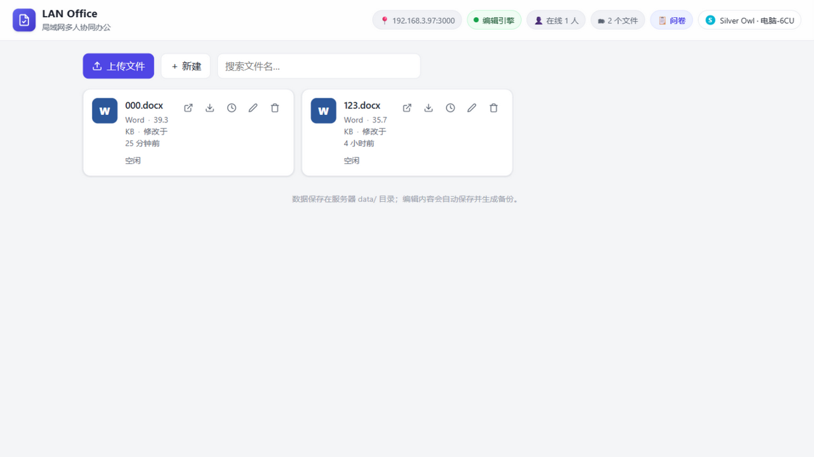
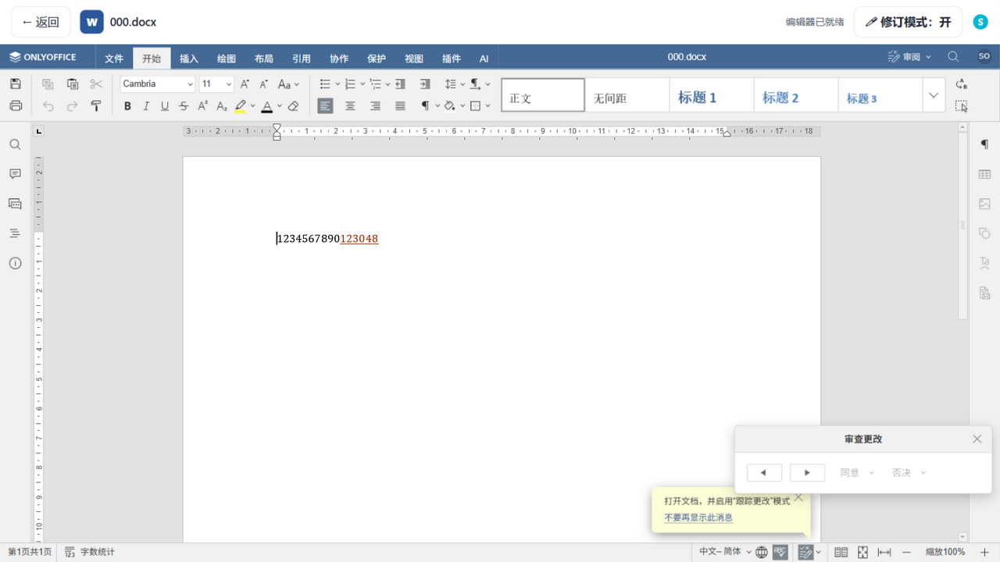
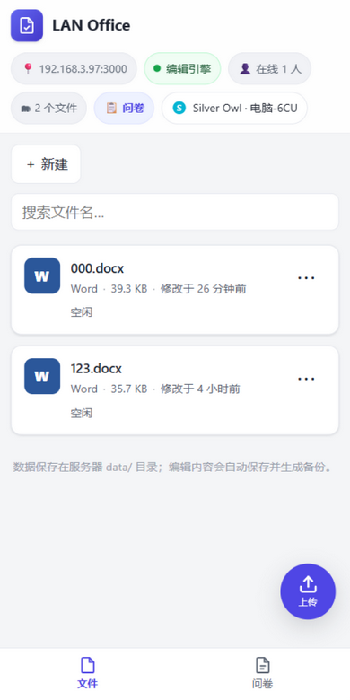
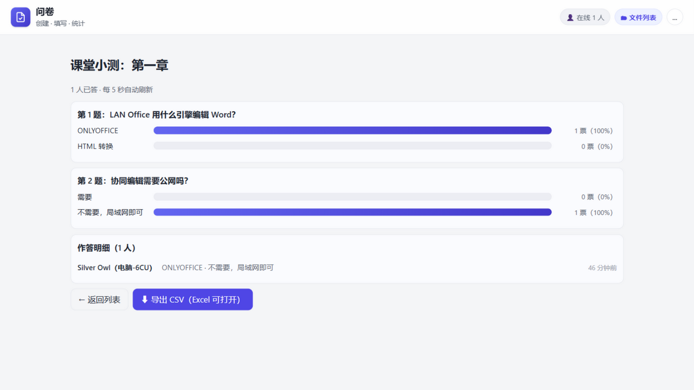

<div align="center">

# 🏠 LAN Office

**局域网里的多人协同 Office 编辑器 —— 电脑双击即用，同一 WiFi 下的手机、平板、电脑一起写文档**

真实编辑 `.docx` `.xlsx` `.pptx` · 实时多人协同 · 修订署名 · 课堂问卷 · 自动备份 · 无需公网 · 免费开源

[](https://github.com/Andy-scy/LAN-Office/releases)
[](LICENSE)
[](https://nodejs.org)
[](#安装)
[](https://github.com/ONLYOFFICE/DocumentServer)

[快速开始](#-快速开始) · [界面预览](#-界面预览) · [功能总览](#-功能总览) · [常见问题](#-常见问题) · [开源调研](docs/research.md) · [🤖 AI Agent Handoff](#-ai-agent-handoff-read-this-first)



*电脑版文件列表 —— 每个文件卡片都能看到类型、大小、修改时间，以及"谁正在编辑"*

</div>

---

## 🤖 AI Agent Handoff (READ THIS FIRST)

> 本节写给将要修改本项目的 AI Agent（Codex / Claude / Cursor / ……）。为精准起见用英文书写；与维护者沟通请用简体中文。
> Written for AI agents that will modify this repo. English for precision; reply to the maintainer in Simplified Chinese. This section mirrors `AGENTS.md` — keep both in sync.

### What this project is

LAN Office is a self-hosted, LAN-only collaborative Office suite for Windows: a Node.js server (file management, presence, persistence) that integrates **ONLYOFFICE Document Server** — an external AGPL process — as the actual `.docx` / `.xlsx` / `.pptx` editing engine, via its HTTP/JS API. No accounts; trusted-LAN threat model.

### Non-negotiable architecture facts

1. **Real editing comes ONLY from ONLYOFFICE Document Server** (separate process, installed by the user, default port 80). NEVER reimplement editing, format conversion, or co-editing: no HTML converters, no custom OT/CRDT, no "simplified" editors. The Node layer is glue, not an editor.
2. **UUID-keyed storage.** Clients address files ONLY by UUID; every path is resolved server-side from `data/documents/index.json` metadata. Any new endpoint must preserve this property — it is what structurally kills path traversal.
3. **`document.key` lifecycle** is `${id}_${version}`. Bump `version` ONLY when nobody is editing (`collaboration.editingCount(id) === 0`) at save time; otherwise live co-editing sessions split. Read `server/onlyoffice.js → applySavedCallback` before touching keys.
4. **The save pipeline is safety-critical and ordered**: DS callback (status 2/3/6/7) → download to `data/temp` → validate (non-empty, `PK` magic for OOXML) → snapshot previous file to `data/backups/<id>/` → atomic `renameSync` → conditional version bump. Do not reorder, parallelize, or skip steps.
5. **Permissions are enforced server-side** in `server/access.js`. Device identity = `x-lan-user` header (UUID from `localStorage`). When `settings.accessEnabled`, upload/create/rename/delete/restore/assign/survey-create are teacher-only. UI hiding is cosmetic; server checks are the authority.
6. **Single-teacher mode**: `access.authTeacher()` demotes every other teacher device. `/api/me` exposes `teacher: {name, dname}` so any device can display who is on duty.
7. **The browser client has no build step** — vanilla JS served statically from `public/`. Do not introduce frameworks, bundlers, npm packages, or TypeScript on the frontend.

### Module map

| Path | Responsibility |
|---|---|
| `server/index.js` | bootstrap: config → dirs → free-port scan (3000+) → banner (prints teacher password) |
| `server/config.js` | loads `config/config.json` over defaults; env overrides: `PORT`, `LANOFFICE_DATA_DIR`, `LANOFFICE_NO_OPEN`, `LANOFFICE_DS_DISABLE` |
| `server/network.js` | LAN IPv4 detection (filters virtual adapters, prefers 192.168.*) |
| `server/fileManager.js` | metadata store (`data/documents/index.json`), filename sanitization, unique-name, backups |
| `server/collaboration.js` | in-memory presence: users/nicknames/devices/colors, per-file rooms |
| `server/onlyoffice.js` | DS healthcheck (probes 80/8080/8090/8000/8888), JWT (auto-reads DS `local.json`), editor-config builder, save callbacks, CommandService (`forcesave`, `meta`) |
| `server/access.js` | groups & permissions (`data/access.json`), single-teacher, file access matrix |
| `server/surveys.js` | survey storage (`data/surveys/*.json`) |
| `server/routes.js` | all REST endpoints; device auth via `x-lan-user` header |
| `server/websocket.js` | Socket.IO presence only — document content sync lives inside DS |
| `public/js/common.js` | shared client core: `App` global, `icon()` SVG set, user/device identity, device-kind sniffing (`<html data-device>`), `bottomSheet` |
| `scripts/test.js` | integration tests (78 assertions) |

### Hard-won traps (do not rediscover these)

- **cmd.exe + UTF-8 `.bat` = silently skipped lines.** `.bat` files MUST be GBK/CP936 encoded and must NOT enable `chcp 65001` before Chinese `echo` lines. Switch to 65001 only right before spawning node, then back to 936. Keep CRLF endings.
- **`crypto.randomUUID` is undefined on insecure origins** (`http://<lan-ip>` — how students actually connect). Client IDs must come from the `randomId()` fallback (`crypto.getRandomValues`); the server validates `/^[0-9a-f-]{8,64}$/i`, and `loadUser` auto-migrates legacy malformed IDs.
- **Multipart filenames arrive latin1-decoded** → run `fixUtf8Name()` and prefer the client-sent `names` JSON field; never trust raw `originalname` for CJK filenames.
- **`copyFileSync` on Windows preserves mtime** → backup filenames include milliseconds; a same-second collision once silently destroyed a backup.
- **JWT is ON by default** (DS ≥ 7.2). The server auto-reads `C:\Program Files\ONLYOFFICE\DocumentServer\config\local.json`; if that fails, users set `ds.jwtSecret` in `config/config.json`.
- **Port 80 is commonly squatted** on Chinese Windows (Steam++/Watt Toolkit accelerator). After install, move DS off 80 (nginx conf) and set `ds.url` in `config/config.json`; the server probes 80/8080/8090/8000/8888.
- **DS must reach the Node server**: callbacks default to `http://127.0.0.1:<port>` (`ds.callbackHost` for cross-host setups).
- **The user is a school teacher and a beginner.** Every UI string is Simplified Chinese; admin surfaces must stay beginner-proof; never ship features that require editing files by hand unless documented in `使用说明.txt`.

### Testing & release conventions

- `npm test` spawns its own server (port 3100) with an isolated data dir — 78 assertions; MUST be green before any commit to `main`. New endpoints need new assertions in `scripts/test.js`.
- Version bumps happen in THREE places together: `package.json`, `server/index.js`, `server/routes.js` (+ README badge).
- `config/config.json` in the repo is the default template. `data/` is runtime state and may contain user documents — never commit it or anything user-specific.
- Commits to `main` are made via the GitHub **Git Data API** (blob → tree → commit → update ref; the maintainer has no local git). Respect `.gitignore`: `data/`, `runtime/`, `node_modules/`, `downloads/`, `.impeccable/`, `onlyoffice-documentserver.exe`, `*.tmp`, `*.log`.
- Encodings: `.bat` → GBK + CRLF; `使用说明.txt` → UTF-8 with BOM + CRLF; everything else UTF-8 (LF fine).

### Language

User-facing strings: Simplified Chinese. Code comments: Chinese is fine. Replies to the maintainer: Simplified Chinese.

---

## ✨ 它能做什么

| | 功能 | 一句话说明 |
|---|---|---|
| 📝 | **真实 Office 编辑** | 浏览器里直接编辑 Word / Excel / PowerPoint，格式保真，不是转 HTML 的假编辑器 |
| 👥 | **多人实时协同** | 同一 WiFi 下大家打开同一文件即进入同一会话，改动能实时看见 |
| 🖊 | **修订模式** | 谁写的哪一段按**作者颜色 + 名字**标注，老师可逐条"同意/否决" |
| 📋 | **课堂问卷** | 几分钟出一套选择题，学生扫码即答，柱状统计 + 明细 + 导出 CSV |
| 💾 | **自动保存 + 备份** | 停手几秒自动落盘；每次保存前自动留档，改错了随时回退 |
| 📱 | **三套自适应 UI** | 电脑 / 平板 / 手机自动识别，各自定制交互（触屏大按钮、底部导航、悬浮上传球） |
| 🏷 | **设备名称** | 每台设备可命名（电脑-6CU、手机-A1），在线列表与答卷明细里分得清清楚楚 |
| 👥 | **分组与权限** | 教师密码解锁管理面板；学生凭 4 位加入码入组，只能编辑本组与公共文档，他组文档隐藏或只读；上传/新建/删除/重命名仅教师可操作 |
| 🔌 | **局域网即用** | 无需公网、无需账号，数据全部留在自己电脑上 |

<div align="center">



*修订模式 —— 红色下划线的"123048"是协作者刚插入的内容，按作者署名标色，可逐条"同意/否决"*

</div>

## 📸 界面预览

**手机版**（触屏大按钮 · 悬浮上传球 · 底部导航）　　**课堂问卷统计**（实时柱状图 · 明细 · 导出 CSV）

|  |  |
|:---:|:---:|

## 🚀 快速开始

### 第一次使用（一次性准备）

1. 双击 **`setup.bat`** —— 自动安装绿色版 Node.js（含 SHA256 校验）、项目依赖，并引导安装 ONLYOFFICE Docs 社区版（编辑引擎，约 1GB 官方安装器）
2. 安装 OnlyOffice 时在弹出的安装界面里：同意协议 → Install → UAC 点"是" → Finish
3. 完成！新手请看 [使用说明.txt](使用说明.txt)，每一步都有保姆级说明

### 以后每天

1. 服务器电脑双击 **`start.bat`**，黑窗口会显示：

```
本机访问:    http://localhost:3000
局域网访问:  http://192.168.3.97:3000   ← 其他设备用这个
```

2. 同一 WiFi 下的设备用浏览器打开"局域网访问"地址 → 上传或新建文档 → 开写！

> 💡 首次启动若弹出 Windows 防火墙提示，勾选"专用网络"并点"允许访问"。

## 🧭 使用文档

**推荐阅读：[使用说明.txt](使用说明.txt)** —— 面向小白的手把手手册，每个功能都写了"怎么用"和"怎么用好"：

- 文件管理：上传的 3 种方式、下载、重命名、删除与后悔药、备份历史恢复
- 多人协同：怎么进入同一会话、自动保存的时机、修订模式怎么开
- 问卷：出卷 → 答题 → 看统计 → 导出 CSV 全流程
- 手机 / 平板三套界面的操作差异、设备名称的用法

## 🔍 开源项目调研

完整调研报告见 [docs/research.md](docs/research.md)。核心结论：**ONLYOFFICE Document Server（AGPL-3.0）** 是唯一同时满足"三件套真实编辑 + 内置实时协同 + Windows 原生安装 + 免费不限人数"的开源引擎，故采用「复用 OnlyOffice 引擎 + 自研轻量 Node.js 服务层」架构：

- ✅ **复用**：文档编辑、格式解析、实时协同合并（引擎内置 OT 机制）
- ✅ **自研**：文件管理（UUID 索引防路径穿越）、在线状态、自动保存管线（下载 → 校验 → 备份 → 原子替换）、局域网引导（网卡探测 / 端口自增 / 防火墙提示 / JWT 密钥自动读取）
- ❌ **明确不做**：假 HTML 转换编辑器、自研 OT/CRDT 重复造轮子

集成方式参考官方 [document-server-integration](https://github.com/ONLYOFFICE/document-server-integration)（Apache-2.0）并做了安全强化。

## ❓ 常见问题

**Q：分组和教师密码怎么用？**
开启"管理面板"（首页点 👩‍🏫 教师图标，默认密码 `1234`，见启动横幅；可在 `config/config.json` 的 `teacherPassword` 修改）→ 创建分组并把 4 位加入码投在黑板上 → 学生打开网站输入加入码入组 → 在"文件归组"里把文档分给各组。其他组文档可设为"完全隐藏"或"只读"。开启后：上传/新建/删除/重命名/问卷创建仅教师可操作。
**同一时间只有一台电脑是教师**：任何界面的"加入分组"弹窗底部都有"我是老师"入口，输入密码即可把当前设备变成教师，之前登录的教师电脑会自动退出；所有设备都能在界面里看到"当前教师是谁"。

**Q：如何修改教师管理密码？**
默认密码 `1234` 建议一定要改。四步完成：

1. 在服务器电脑上停止服务（黑窗口按 Ctrl+C，或直接关掉窗口）；
2. 用记事本打开项目目录下的 **`config\config.json`**；
3. 找到这一行，把 `1234` 改成你的新密码后保存：

   ```json
   "teacherPassword": "1234"
   ```

4. 重新双击 `start.bat`，启动横幅会显示新密码，确认即可。

> 建议 4~8 位数字（学生要在手机/平板上输入），别用生日这类容易猜到的组合。
> 注意：改密码后，之前已登录教师身份的电脑**仍保留身份**，直到有新电脑用新密码登录一次（单一教师模式，登录即接管）。想让旧电脑立刻失效，改完密码后随手在另一台设备登录一次即可。

**Q：能打开文件列表，但显示"编辑引擎未连接"？**
服务器上未安装或未启动 ONLYOFFICE Docs。重跑 `setup.bat`，或按"快速开始"手动安装。

**Q：编辑器报 Token / JWT 错误？**
OnlyOffice 7.2+ 默认启用 JWT。LAN Office 会自动读取 `C:\Program Files\ONLYOFFICE\DocumentServer\config\local.json` 的密钥；若读取失败，把其中 `services.CoAuthoring.secret.inbox.string` 的值填入 `config/config.json` 的 `ds.jwtSecret` 后重启。

**Q：其他设备打不开网址？**
确认连的是同一个 WiFi；首次运行在防火墙提示里点"允许"；或管理员运行
`netsh advfirewall firewall add rule name="LAN Office" dir=in action=allow protocol=TCP localport=3000`。

**Q：网址端口不是 3000？**
被占用会自动换 3001、3002……以启动横幅显示的为准。

**Q：setup.bat 下载 OnlyOffice 失败或很慢？**
安装器约 1GB 走 GitHub 发布渠道，向导已内置断点续传与 TLS 兼容修复（`--ssl-no-revoke`，解决 `CRYPT_E_REVOCATION_OFFLINE`），重跑会接着下。也可手动从 [Releases](https://github.com/ONLYOFFICE/DocumentServer/releases/latest) 下载 `onlyoffice-documentserver.exe` 放进项目根目录，向导会直接使用。

**Q：80 端口被别的程序占用（如 Steam++ 加速器）？**
OnlyOffice 默认用 80 端口。安装前先退出占用程序；安装后可修改其 nginx 配置换端口，并在 `config/config.json` 的 `ds.url` 里指定。

**Q：文件存在哪？想整体备份？**
都在项目目录的 `data\` 里。整体备份 = 复制整个 `data\` 文件夹。

## ⚠️ 已知限制

- 在线编辑必须安装 ONLYOFFICE Docs 社区版（界面带 OnlyOffice 品牌；免费、不限人数，建议服务器 4GB 内存）
- `.pdf` 仅支持查看；Excel 与 PPT 无修订归属机制（格式限制），仍保留彩色光标
- 无账号系统（面向局域网信任环境）；Document Server 崩溃时未保存的会话内容会丢失
- 极端并发下保存瞬间加入的编辑者可能拆分为两个会话（官方集成模式的已知边界，后保存者覆盖）

## 📄 开源协议

- 本项目自身代码以 **MIT** 协议发布（见 [LICENSE](LICENSE)）
- [ONLYOFFICE Document Server](https://github.com/ONLYOFFICE/DocumentServer) 由 ONLYOFFICE 开发，**AGPL-3.0**，不随本项目分发、由用户独立安装，经进程间 HTTP API 集成
- npm 依赖清单见 [LICENSES-THIRD-PARTY.md](LICENSES-THIRD-PARTY.md)

## 🗺 后续计划

- [ ] 可选访问口令（房间密码）
- [ ] 文件回收站（删除可撤销）
- [ ] 问卷支持多选题与匿名模式
- [ ] HTTPS 局域网访问
- [ ] 打包免装 Node 的绿色发行版

---

<div align="center">

**LAN Office** · 把局域网变成一间可以共同书写的教室 🏫

<sub>如果对你有帮助，欢迎点个 Star ⭐</sub>

</div>
